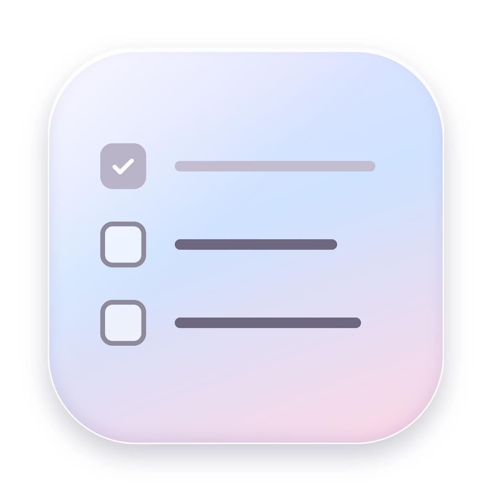

<p align="center">
  
</p>

<h1 align="center">Bubblist</h1>

<p align="center">
  A floating glass to-do list for your Mac.<br>
  A little bubble lives on your desktop. Click it, and your day slides out.
</p>

---

Bubblist is a tiny, quiet to-do list that stays out of your way. There's no
window to manage and no Dock icon. There's just a glass bubble that floats above
everything, showing how many tasks are left today. Click it to pull out a
see-through panel with your list, tick things off (with confetti), and click away
to tuck it back.

## Features

- **Floating bubble.** Always on top, on every Space. Drag it anywhere; it
  remembers where you left it. Shows today's remaining count.
- **Real glass.** Uses Apple's Liquid Glass on macOS 26, and falls back to the
  system blur on older versions.
- **Day tabs.** *Week*, *Today*, *Tomorrow*, plus any day you add with **+**.
  The panel always opens on Today. Added days can be deleted.
- **Sections.** work · study · life · admin. Click a heading to collapse it.
- **Daily and weekly tasks.** Toggle **↻ daily** (or **↻ weekly** on the Week
  tab) when adding. They show up every day or week, and checking one off only
  counts for that day or week.
- **Nothing gets lost.** Unfinished tasks from past days roll into Today, marked
  `(from Oct 25)`. The same goes for past weeks.
- **Drag and drop.** Reorder tasks, move them between sections, or drop one on
  a day tab to reschedule it.
- **Confetti.** Every finished task gets a burst; clearing a whole tab gets a
  bigger one.
- **Private.** Everything is stored locally as a JSON file. No accounts, no
  network.

## Install

Bubblist is for **macOS** (Apple Silicon or Intel). Liquid Glass needs macOS 26
or later; older versions get a frosted blur instead.

### Download

1. Grab `Bubblist-mac-arm64.zip` (Apple Silicon) from the
   [latest release](https://github.com/amoveablefeastym/bubblist/releases/latest).
2. Unzip it and drag **Bubblist.app** into **Applications**.
3. The app isn't notarized by Apple, so the first launch is blocked. Either
   right-click the app, choose **Open**, then **Open** again, or run:

   ```bash
   xattr -dr com.apple.quarantine /Applications/Bubblist.app
   ```

On Intel Macs, build from source (below). It takes about a minute.

### Build from source

You'll need [Node.js](https://nodejs.org) 20 or newer.

```bash
git clone https://github.com/amoveablefeastym/bubblist.git
cd bubblist
npm install
npm run install-app   # builds Bubblist.app, copies it to /Applications, and opens it
```

Bubblist adds itself to your login items the first time it runs, so it's there
whenever you start your Mac.

## Using it

| To… | Do this |
| --- | --- |
| Open or close the list | Click the bubble, or press **⌘⇧Space** anywhere |
| Hide it | **Esc**, or click anywhere outside the panel |
| Add a task | Type in **Add new todo** and press **Enter**. Pick a section and **↻ daily/weekly** in the row below. |
| Edit a task | Double-click its text |
| Delete a task | Hover it and click **×** |
| Reschedule | Drag the task onto another day tab (or **Week**) |
| Add a day | Click **+** at the end of the tabs |
| Delete a day | Hover its tab and click **×** |
| Collapse a section | Click its heading |
| Move the bubble | Drag it |
| Quit, or turn off open at login | Right-click the bubble |

Your tasks are saved in `~/Library/Application Support/bubblist/todos.json`.

## Development

```bash
npm install
npm start          # run from source
npm run package    # build dist/Bubblist-darwin-<arch>/Bubblist.app
```

The app is plain Electron with no bundler and no framework.

| File | What it does |
| --- | --- |
| `main.js` | Creates the bubble and panel windows, handles dragging the bubble, Liquid Glass, saving, and the login item |
| `preload.js` | The small bridge between the windows and the main process |
| `bubble.html` | The floating bubble |
| `panel.html` / `panel.css` / `panel.js` | The to-do panel: tabs, sections, drag and drop, confetti |
| `build/` | App icon, packaging script, and Info.plist additions |

If you run `npm start` from a VS Code terminal, the script unsets
`ELECTRON_RUN_AS_NODE` for you, because VS Code sets it and it stops Electron
from starting. Packaged builds have this turned off entirely.

## Contributing

Issues and pull requests are welcome. Ideas that would fit nicely:

- Custom sections (rename, add, recolor)
- A dark glass theme
- A notarized, universal (arm64 + x64) release build
- Windows and Linux support (the bubble works; the glass needs a substitute)

Please keep the spirit: small, calm, and fast.

## Credits

- Liquid Glass bridge: [electron-liquid-glass](https://github.com/Meridius-Labs/electron-liquid-glass)
- Built with [Electron](https://www.electronjs.org)

## License

[MIT](LICENSE)
